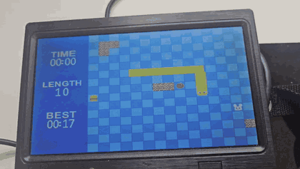

# 🐍 Slimming Snake: A Snake Game in Hardware (FPGA)

A twist on the classic Snake game, implemented entirely in **SystemVerilog** on an **Intel FPGA (DE10-Standard board)**. Built as a pair project in the Electrical Engineering Lab at the Technion.

The twist: **the goal is not to grow, it is to slim down.** The snake starts long, and the player has to eat the right food to shrink it down to a single cell as fast as possible.

There is no processor and no software here. Every part of the game (movement, collisions, randomness, graphics, the timer and the sound) is digital logic running on the FPGA.

<!-- Add a GIF or a screenshot here, e.g.:  -->

## How to Play

| Item | Effect |
|---|---|
| 🍎 Apple | Snake shrinks by 1 |
| 🍔 Burger | Snake grows by 1 |
| 🐭 Mouse (moves around the board) | Catch it to shrink by 3 |
| 🧱 Obstacles, walls, your own body | Game over |

- The snake starts at length **10**. Reach length **1** to win.
- Pick a difficulty (**1** / **2** / **3** on the keyboard, then **Enter**): Easy, Medium or Hard.
- **The thinner the snake gets, the faster it moves.** Every 3 cells lost raises the speed, and harder levels start faster.
- Each game picks one of **16 obstacle layouts** at random.
- A side panel shows the elapsed time, the current length and your **best time**.

## Technical Highlights

- **Main game FSM:** Start screen → Level select → Init → Playing → Win / Lose, driven by keyboard events converted to single-clock pulses (edge detection).
- **VGA output:** 640×480 graphics generated in real time from a 31.5 MHz pixel clock (PLL). The 15×15 board uses 32×32-pixel cells, and a priority multiplexer layers all the on-screen objects.
- **Smooth movement:** the snake moves continuously between cells using fixed-point arithmetic (1/64-pixel resolution) instead of jumping a cell per step. Turns are applied only at cell boundaries.
- **Collision detection:** wall and self collisions are checked on the grid each time the head enters a new cell. Food, obstacle and mouse collisions are detected at the pixel level from overlapping drawing requests.
- **Random food spawning:** an 8-bit **LFSR** generates candidate cells. A small FSM, together with a 225-bit **occupancy matrix** that tracks the snake, obstacles and other items, retries until it finds a free cell.
- **Dynamic speed control:** speed is derived from the snake's length and the selected level.
- **Graphics from ROM:** sprites and full screens (title, level select, win and game-over screens) are stored as `.mif` bitmaps.
- **Extras:** a PS/2 keyboard interface, a 7-segment timer and background music through the board's audio codec.

## Project Structure

```
RTL/
├── game_params.sv          Shared constants (board size, cell size, snake lengths, levels)
├── lfsr.sv                 Pseudo-random number generator
├── VGA/                    Core game logic and rendering
│   ├── game_controller.sv      Main game state machine
│   ├── snake_move.sv           Snake head movement (fixed-point)
│   ├── body_logic.sv           Snake body tracking
│   ├── collision_detector.sv   All collision checks
│   ├── occupancy_matrix.sv     Which board cells are taken
│   ├── spawn_controller.sv     Random food placement
│   ├── snake_length_manager.sv Length updates and win condition
│   ├── speed_controller.sv     Speed by level and length
│   ├── mouse_move.sv           Moving mouse logic
│   ├── obstacle_matrix.sv      16 random obstacle layouts
│   ├── side_panel_draw.sv      Time / best / length display
│   └── VGA_Controller.sv       VGA timing
├── screen/                 Start, level-select, win and lose screens
├── KEYBOARDX/              Keyboard decoding
├── Seg7/                   7-segment timer
└── AUDIO/                  Music player
Lab1Demo.qpf / .qsf         Quartus project and pin assignments
```

## Tools

- Intel Quartus Prime
- SystemVerilog, plus Quartus block diagrams (`.bdf`) for top-level wiring
- Terasic DE10-Standard board (Intel Cyclone V), VGA monitor, PS/2 keyboard

## Authors

Hananya Rem & Alon Malina
Electrical Engineering Lab, Technion – Israel Institute of Technology

*Built on base templates provided by the course staff (VGA controller, keyboard interface, audio).*
